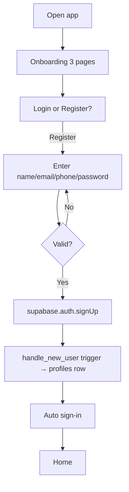
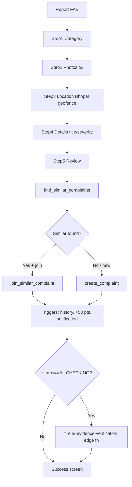
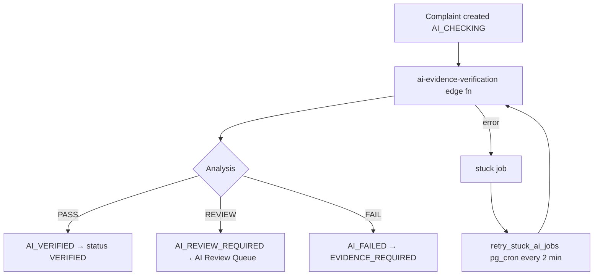
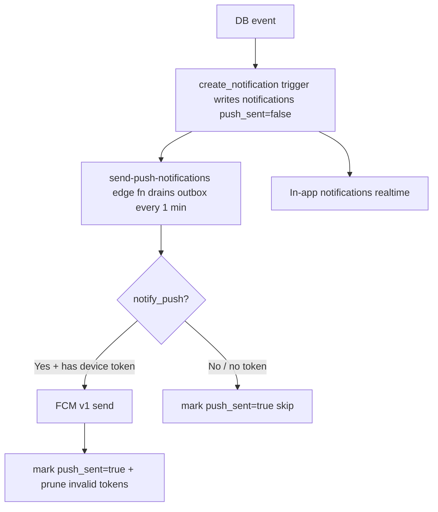
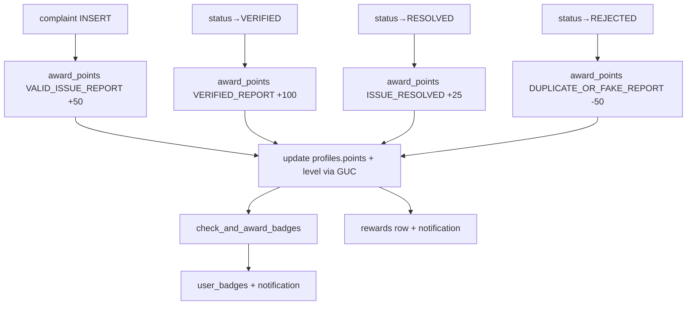
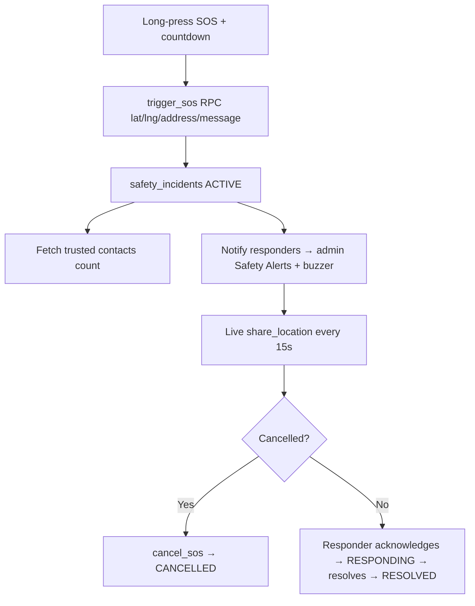

# JanMitra — End-to-End Workflows

> **Document version:** 1.0  
> **Generated:** 2026-09-30

Mermaid flowcharts are used where helpful. Status values reflect the live schema
(as used by the mobile/admin apps), not just the 6-value repo enum.

---

## A. Citizen Registration

## B. Citizen Login
Email → `signInWithPassword`. Phone → `resolve_phone_login` → email → `signInWithPassword`. → Home.

## C. Complaint Creation

## D. Evidence Upload
Photos → `complaint_images` bucket (`<uid>/<ts>_<rand>.<ext>`) → image_url + storage_path → passed to `create_complaint`/`add_evidence_to_complaint`.

## E. AI Validation

AI failure NEVER silently rejects — it routes to human review.

## F. Manual Verification (Human Review)
AI Review Queue / detail AI panel → officer reviews evidence → `officer_review_complaint` (verify/reject/request-evidence + structured reason) → update `complaint_ai_verification` + status + `audit_logs` + notifications.

## G. More Evidence Requested
Officer chooses EVIDENCE_REQUIRED → `evidence_request_message` set → citizen sees AI status banner "Upload New Photos" → `add_evidence_to_complaint` → re-queue AI.

## H. Citizen Adds Additional Evidence
Complaint detail (EVIDENCE_REQUIRED/AI_FAILED) → pick multi-image → upload → `add_evidence_to_complaint` (ownership enforced) → images appended as new round → re-queue AI.

## I. Complaint Verification
Status → VERIFIED (by AI auto-pass or human verify) → +100 points → notification.

## J. Department Determination
Admin/automation determines department from category mapping → `manual_assign_complaint` (or auto-assign [specified]).

## K. Officer Assignment
`manual_assign_complaint` (dept + officer) → status ASSIGNED → `complaint_assignments` record + history + notifications (citizen + officer). Auto-assignment by jurisdiction/distance/workload is **specified but not confirmed implemented**.

## L. Officer Acknowledgement
Officer views assignment → acknowledges → status ACKNOWLEDGED (admin transition).

## M. Work in Progress
Status → IN_PROGRESS → notification.

## N. Resolution Evidence
Officer uploads before/after → `resolution_evidence` table → status RESOLUTION_SUBMITTED.

## O. Resolution Review
Status → UNDER_REVIEW → community verification opens (`verification_status=pending`).

## P. Resolved
Status → RESOLVED → `resolved_at` set → +25 points → `verifiable_complaints` lists it.

## Q. Closed
Status → CLOSED after community confirms (or admin closes).

## R. Reopened
Community dispute (verification_rate below threshold) OR admin reopen → `reopen_complaint` → status REOPENED → `verification_status=reopened` → notification → back to assignment/in-progress.

## S. SLA Breach
`sla_deadline` < now() AND active → SLA page shows breached → toast on dashboard → escalate → severity HIGH.

## T. Escalation
Admin escalate dialog → reason → severity HIGH + history + notification.

## U. Notification Lifecycle

## V. Gamification Lifecycle

All server-controlled (`award_points` is service_role only; `protect_reputation_columns` trigger blocks client writes).

## W. SOS Lifecycle

## X. Safety Alert Lifecycle (Admin)
`get_active_safety_alerts` → flashing banner → alert card (location, contacts, message) → acknowledge (`acknowledge_safety_alert`) → resolve (`resolve_safety_incident`). Buzzer fires on new active alert.

## Y. Police Assignment
**Specified but not confirmed implemented:** closest police officer/station selection by location. Admin can acknowledge/resolve safety alerts. Full auto-dispatch logic is a future enhancement.

## Z. Analytics Lifecycle
`get_dashboard_complaints` + `get_analytics_summary` + sub-RPCs → admin analytics page → recharts → date-range filter → realtime invalidation on complaints changes.
