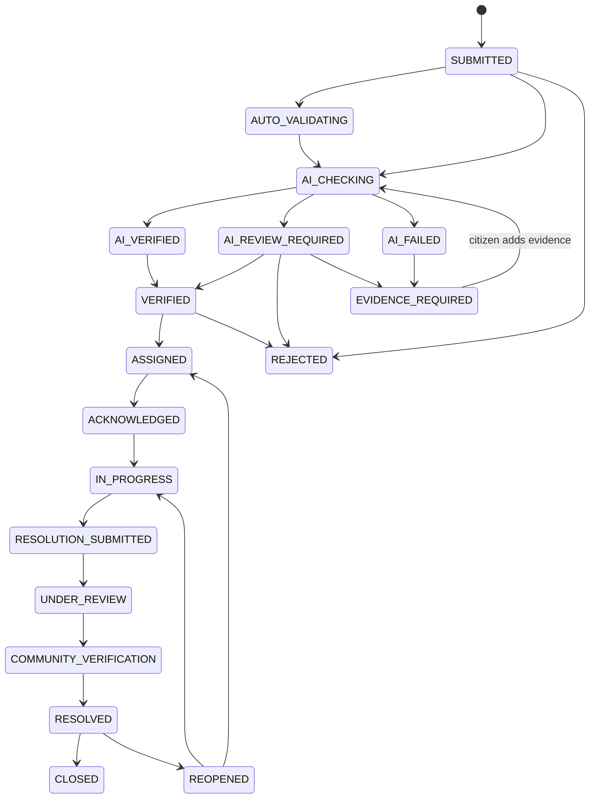

# JanMitra — Complaint Lifecycle Specification

> **Document version:** 1.0  
> **Generated:** 2026-09-30

> **Important:** The version-controlled `01_schema.sql` defines the `complaint_status`
> enum with only **6 values**: `SUBMITTED, VERIFIED, ASSIGNED, IN_PROGRESS, RESOLVED,
> REJECTED`. The mobile app (`complaint_status.dart`) and admin frontend
> (`lib/workflow.ts`) use **~19–20 values**. The live Supabase project clearly has an
> extended enum (via `ALTER TYPE ADD VALUE` applied outside the repo). This document
> documents the **full live lifecycle** as used by the apps, and notes which
> transitions are enforced by repo SQL vs. by live RPCs/triggers.

---

## 1. Status Definitions

| Status | Meaning | Enforced by |
|--------|---------|-------------|
| SUBMITTED | Citizen filed; awaiting validation | Repo enum |
| AUTO_VALIDATING | AI validation in progress | Live enum (app) |
| AI_CHECKING | AI edge function running | Live enum (app) |
| AI_VERIFIED | AI passed automatically | Live enum (app) |
| AI_REVIEW_REQUIRED | AI flagged for human review | Live enum (app) |
| AI_FAILED | AI analysis failed → evidence needed | Live enum (app) |
| EVIDENCE_REQUIRED | More evidence requested | Live enum (app) |
| VERIFIED | Human-verified (or AI auto-pass) | Repo enum |
| NEEDS_REVIEW | Needs human review | Live enum (app) |
| ASSIGNED | Assigned to department/officer | Repo enum |
| ACKNOWLEDGED | Officer acknowledged assignment | Live enum (app) |
| IN_PROGRESS | Officer working | Repo enum |
| RESOLUTION_SUBMITTED | Officer submitted resolution evidence | Live enum (app) |
| UNDER_REVIEW | Resolution under review | Live enum (app) |
| COMMUNITY_VERIFICATION | Open for community verification | Live enum (app) |
| RESOLVED | Resolved; pending community confirmation | Repo enum |
| CLOSED | Closed (community confirmed or admin) | Live enum (app) |
| REOPENED | Reopened by dispute or admin | Live enum (app) |
| REJECTED | Rejected (invalid/fake) | Repo enum |

> The `complaints.verification_status` text column (added in `10_community_verification.sql`)
> holds `pending`/`confirmed`/`reopened`/`needs_review` and gates the community
> verification sub-state independently of `status`.

---

## 2. State Transition Diagram

---

## 3. State Transition Matrix

| Current State | Action | Next State | Actor | Conditions | Notification | Audit Event |
|---------------|--------|------------|-------|------------|--------------|-------------|
| (none) | create_complaint | SUBMITTED or AI_CHECKING | Citizen | valid + idempotency | COMPLAINT_SUBMITTED | status_history row |
| SUBMITTED | start AI | AI_CHECKING | System/AI | edge fn invoked | — | — |
| AI_CHECKING | AI pass | AI_VERIFIED → VERIFIED | AI | decision PASS | COMPLAINT_VERIFIED | ai_verification row |
| AI_CHECKING | AI review | AI_REVIEW_REQUIRED | AI | decision REVIEW | — | ai_verification row |
| AI_CHECKING | AI fail | AI_FAILED → EVIDENCE_REQUIRED | AI | decision FAIL | EVIDENCE_REQUIRED | ai_verification row |
| AI_REVIEW_REQUIRED | officer verify | VERIFIED | Officer/Admin | `officer_review_complaint` decision VERIFIED | COMPLAINT_VERIFIED | audit_logs OFFICER_REVIEW |
| AI_REVIEW_REQUIRED | officer reject | REJECTED | Officer/Admin | decision REJECTED | COMPLAINT_REJECTED | audit_logs |
| AI_REVIEW_REQUIRED | officer request evidence | EVIDENCE_REQUIRED | Officer/Admin | decision EVIDENCE_REQUIRED | EVIDENCE_REQUIRED | audit_logs |
| EVIDENCE_REQUIRED | citizen adds evidence | AI_CHECKING | Citizen | `add_evidence_to_complaint` | — | — |
| AI_FAILED | citizen adds evidence | AI_CHECKING | Citizen | `add_evidence_to_complaint` | — | — |
| VERIFIED | assign | ASSIGNED | Officer/Admin | `manual_assign_complaint` | COMPLAINT_ASSIGNED (citizen + officer) | complaint_assignments + history |
| ASSIGNED | acknowledge | ACKNOWLEDGED | Officer | admin transition | — | history |
| ACKNOWLEDGED | start work | IN_PROGRESS | Officer | admin transition | COMPLAINT_IN_PROGRESS | history |
| IN_PROGRESS | submit resolution | RESOLUTION_SUBMITTED | Officer | resolution_evidence uploaded | — | history |
| RESOLUTION_SUBMITTED | review | UNDER_REVIEW | Officer/Admin | — | — | history |
| UNDER_REVIEW | open community | COMMUNITY_VERIFICATION | System | `verification_status=pending` | — | — |
| COMMUNITY_VERIFICATION | confirm | RESOLVED | System/Admin | sufficient verifications | COMPLAINT_RESOLVED | resolved_at set |
| RESOLVED | close | CLOSED | Admin | community confirm or admin | — | history |
| RESOLVED | dispute reopen | REOPENED | System/Admin | `verification_status=reopened` | — | history |
| REOPENED | reassign | ASSIGNED/IN_PROGRESS | Officer/Admin | — | — | history |
| SUBMITTED/VERIFIED | reject | REJECTED | Officer/Admin | — | COMPLAINT_REJECTED (skipped in 06 trigger) | history |
| REJECTED | (terminal) | — | — | — | — | — |
| CLOSED | (terminal) | — | — | — | — | — |

**Rewards tied to transitions** (via `apply_status_rewards` trigger, repo `07`):
- → VERIFIED: +100 (VERIFIED_REPORT)
- → RESOLVED: +25 (ISSUE_RESOLVED)
- → REJECTED: −50 (DUPLICATE_OR_FAKE_REPORT)
- INSERT complaint: +50 (VALID_ISSUE_REPORT)

---

## 4. Who Can Perform Each Transition

Repo `is_admin()` checks JWT `app_metadata.role` ∈ {admin, system_admin, department_admin, officer}. `officer_review_complaint` additionally allows an active `officers` row.

| Transition | Citizen | Officer | Dept Admin | System Admin | AI/System |
|------------|--------|---------|------------|--------------|----------|
| create | ✅ | — | — | — | — |
| add evidence (own) | ✅ | — | — | — | — |
| delete (pre-verify, own) | ✅ | — | — | — | — |
| AI pass/review/fail | — | — | — | — | ✅ |
| verify/reject/request-evidence | — | ✅ | ✅ | ✅ | — |
| assign | — | ✅ | ✅ | ✅ | ✅ (auto, specified) |
| acknowledge/in-progress | — | ✅ | ✅ | ✅ | — |
| submit resolution | — | ✅ | ✅ | ✅ | — |
| close | — | — | ✅ | ✅ | — |
| reopen | ✅ (community) | — | ✅ | ✅ | — |
| escalate | — | — | ✅ | ✅ | — |
| suspend/restore citizen | — | — | — | ✅ | — |
| bulk delete | — | — | — | ✅ | — |

Server-side enforcement: RLS + SECURITY DEFINER RPCs (`officer_review_complaint`, `manual_assign_complaint`, `reopen_complaint`, `bulk_delete_complaints`). Frontend `canXxx()` helpers are UX-only.
