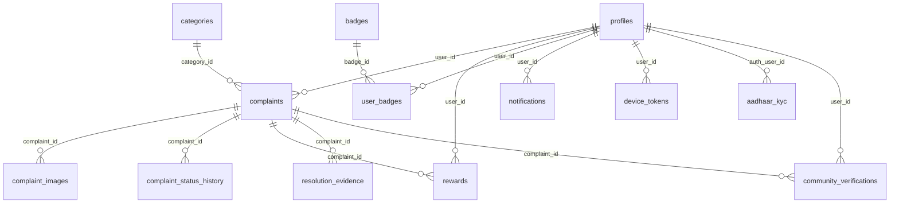

# JanMitra — Database Design Document

> **Document version:** 1.0  
> **Generated:** 2026-09-30  
> **Source:** `D:\Janmitra\JanMitra\database\` (all numbered SQL files + `janmitra_full_setup.sql`).

> **Critical:** The repo's version-controlled SQL creates the **public schema**
> core tables (profiles, categories, complaints, complaint_images,
> complaint_status_history, rewards, badges, user_badges, notifications,
> device_tokens, reward_rules, level_config, resolution_evidence,
> community_verifications, aadhaar_kyc). Many additional tables (officers,
> departments, complaint_ai_verification, safety_*, automation_*, civic_incidents,
> duplicate_links, complaint_assignments, sla_rules, audit_logs, system_config,
> user_settings, notification_preferences, category_ai_config,
> assignment_audit_logs, notification_config) are **referenced by migrations
> 12–14 and the mobile/admin apps but NOT created in version-controlled SQL**.
> They exist on the live Supabase project (applied directly). Below, **created
> tables** are documented from the SQL; **referenced-only tables** are documented
> from inferred usage and labeled **[S]**.

---

## Schema Overview

## Extensions

| Extension | Schema | Purpose | File |
|-----------|--------|---------|------|
| `postgis` | extensions | geography(point,4326), ST_DWithin, ST_Distance, ST_AsGeoJSON, GiST | 01 |
| `pg_trgm` | extensions | similarity(title) for duplicate detection | 11 |
| `pgcrypto` | extensions | digest(…,'sha256') for Aadhaar | 13 |
| `pg_net` | (not CREATE EXTENSION'd in repo) | net.http_post for AI retry | 14 |
| `pg_cron` | (not enabled in repo) | schedule retry_stuck_ai_jobs | 14 |

---

## Table: `profiles` — Citizen accounts (01; aug 12, 16)

| Column | Type | Null | Default | Notes |
|--------|------|------|---------|-------|
| id | uuid | NO | gen_random_uuid() | PK |
| auth_user_id | uuid | NO | — | UNIQUE; FK→auth.users ON DELETE CASCADE |
| name | text | NO | — | |
| email | text | YES | — | unique idx profiles_email_uniq (15) lower(btrim) |
| phone | text | YES | — | unique idx profiles_phone_normalized_uniq (12) normalize_phone(phone) |
| avatar_url | text | YES | — | |
| points | integer | NO | 0 | check dropped in 07 (allows negative) |
| level | integer | NO | 1 | check level >= 1 |
| created_at | timestamptz | NO | now() | |
| updated_at | timestamptz | NO | now() | |
| city | text | YES | — | (16) |
| ward | text | YES | — | (16) |
| notify_push | boolean | NO | true | (16) |
| notify_email | boolean | NO | true | (16) |
| notify_in_app | boolean | NO | true | (16) |
| privacy_show_leaderboard | boolean | NO | true | (16) |
| privacy_show_ward | boolean | NO | true | (16) |

- **PK:** id. **Unique:** auth_user_id; email (idx); phone (idx).
- **FK:** auth_user_id → auth.users.
- **Triggers:** `profiles_set_updated_at` (BEFORE UPDATE→set_updated_at); `profiles_protect_reputation` (BEFORE INSERT OR UPDATE→protect_reputation_columns).
- **RLS:** enabled. SELECT/INSERT/UPDATE own (`auth_user_id = auth.uid()`).

## Table: `categories` (01)

| id | uuid PK | name text UNIQUE | description text | icon text | active boolean default true | created_at |

- **RLS:** enabled. SELECT where active=true (public/anon).

## Table: `complaints` (01; aug 10)

| Column | Type | Null | Default | Notes |
|--------|------|------|---------|-------|
| id | uuid | NO | gen_random_uuid() | PK |
| complaint_number | text | NO | generate_complaint_number() | UNIQUE |
| user_id | uuid | NO | — | FK→profiles ON DELETE CASCADE |
| category_id | uuid | NO | — | FK→categories ON DELETE RESTRICT |
| title | text | NO | — | check char_length 3..200 |
| description | text | YES | — | |
| severity | complaint_severity | NO | MEDIUM | |
| status | complaint_status | NO | SUBMITTED | |
| location | geography(point,4326) | YES | — | PostGIS |
| address | text | YES | — | |
| created_at | timestamptz | NO | now() | |
| updated_at | timestamptz | NO | now() | |
| resolved_at | timestamptz | YES | — | set by record_status_change on RESOLVED |
| sla_deadline | timestamptz | YES | — | column exists; no engine populates it (repo) |
| idempotency_key | text | YES | — | |
| verification_status | text | YES | — | (10) check in (pending,confirmed,reopened,needs_review) |

- **Referenced-but-MISSING columns** [S]: assigned_department_id, ward, evidence_request_message (used by 12/13, never ALTER'd in repo).
- **Indexes:** user_id, category_id, status, created_at desc, location GiST, (user_id, idempotency_key) UNIQUE.
- **Triggers:** set_updated_at; create_initial_history (AFTER INSERT); record_status_change (BEFORE UPDATE OF status); notify_submitted (AFTER INSERT); notify_status_change (AFTER UPDATE OF status); award_report_points (AFTER INSERT); apply_status_rewards (AFTER UPDATE OF status).
- **RLS:** enabled. SELECT/INSERT own (`user_id = current_profile_id()`). No UPDATE/DELETE (status via RPC; delete via RLS-less path/service). Deliberately no "view all" SELECT (privacy).

## Table: `complaint_images` (01)

| id uuid PK | complaint_id uuid FK→complaints CASCADE | storage_path text | image_url text | created_at |

- **RLS:** enabled. SELECT/INSERT own (`is_own_complaint`).

## Table: `complaint_status_history` (01)

| id uuid PK | complaint_id uuid FK CASCADE | status complaint_status | comment text | updated_by uuid FK→auth.users SET NULL | created_at |

- **RLS:** enabled. SELECT own (`is_own_complaint`). Written only by triggers/RPCs.

## Table: `rewards` (01; idx 07)

| id uuid PK | user_id uuid FK→profiles CASCADE | complaint_id uuid FK→complaints SET NULL | activity_type text | points integer default 0 | description text | created_at |

- **Indexes:** user_id; (user_id, created_at desc); activity_type; (complaint_id, activity_type) UNIQUE WHERE complaint_id IS NOT NULL.
- **RLS:** enabled. SELECT own. **No INSERT/UPDATE** (default deny; only SECURITY DEFINER functions write).
- **Trigger:** `rewards_notify_earned` (AFTER INSERT → notify_reward_earned).

## Table: `badges` (01; reworked 07)

| id uuid PK | name text UNIQUE | description text | icon text | criteria text (treated as JSON via ::jsonb) | created_at |

- **RLS:** enabled. SELECT true (public).

## Table: `user_badges` (01)

| id uuid PK | user_id uuid FK→profiles CASCADE | badge_id uuid FK→badges CASCADE | earned_at timestamptz default now() |

- **Unique:** (user_id, badge_id).
- **RLS:** enabled. SELECT own. **No INSERT** (default deny; only check_and_award_badges writes).
- **Trigger:** `user_badges_notify_earned` (AFTER INSERT → notify_badge_earned).

## Table: `notifications` (01; cols 06)

| id uuid PK | user_id uuid FK→profiles CASCADE | title text | message text | type text | is_read boolean default false | read_at timestamptz (06) | complaint_id uuid FK→complaints SET NULL (06) | data jsonb (06) | push_sent boolean default false (06) | created_at |

- **Indexes:** user_id; complaint_id; unread (user_id WHERE is_read=false); push_pending (created_at WHERE push_sent=false).
- **RLS:** enabled. SELECT/UPDATE own. **No INSERT** (trigger-only via create_notification, revoked from all roles).

## Table: `device_tokens` (01; re-declared 06)

| id uuid PK | user_id uuid FK→profiles CASCADE | token text UNIQUE | platform text check in (android,ios,web,unknown) default unknown | created_at | last_used_at default now() |

- **RLS:** enabled. SELECT/INSERT/UPDATE/DELETE own.

## Table: `reward_rules` (07)

| activity_type text PK | title text | points integer | description text | active boolean default true | created_at | updated_at |

- **RLS:** enabled. SELECT where active=true (authenticated).

## Table: `level_config` (07)

| level integer PK check >=1 | title text | min_points integer check >=0 | created_at |

- **RLS:** enabled. SELECT true (authenticated).

## Table: `resolution_evidence` (10)

| id uuid PK | complaint_id uuid FK→complaints CASCADE | storage_path text | image_url text | uploaded_by uuid FK→auth.users SET NULL | caption text | created_at |

- **RLS:** enabled. SELECT/INSERT authenticated; DELETE admin (`is_admin()`).

## Table: `community_verifications` (10)

| id uuid PK | complaint_id uuid FK→complaints CASCADE | user_id uuid FK→profiles CASCADE | verified boolean | comment text | created_at |

- **Unique:** (complaint_id, user_id).
- **RLS:** enabled. SELECT authenticated; INSERT own (`user_id = current_profile_id()`).

## Table: `aadhaar_kyc` (13)

| id uuid PK | auth_user_id uuid UNIQUE FK→auth.users CASCADE | aadhaar_hash text | aadhaar_masked text | full_name text check length>=3 | status text check in (pending,verified,rejected) default pending | verified_at timestamptz | rejected_reason text | created_at | updated_at |

- **Index:** status WHERE status <> 'verified'.
- **Trigger:** set_updated_at.
- **RLS:** enabled. SELECT own (`auth_user_id = auth.uid()`).

---

## Referenced-Only Tables [S] (NOT created in version-controlled SQL)

### `complaint_ai_verification` [S]
Inferred columns: id (PK), complaint_id (FK→complaints), status (text: pending/analyzing/completed/error), selected_category, image_count, ai_decision (enum ai_decision: PASS/REVIEW), reason, category_match, evidence_quality, detected_category, description_match, reviewed_by (uuid), reviewed_at, review_decision (VERIFIED/REJECTED/EVIDENCE_REQUIRED), review_reason, created_at. Added by 12: review_reason_type. Added by 14: started_at, completed_at, failed_at, attempt_count default 0, last_error. **RLS:** SELECT/UPDATE admin (`is_admin()`).

### `ai_decision` enum [S]
At least `PASS`, `REVIEW`. Not created in repo.

### `officers` [S]
Inferred: profile_id (FK→profiles), active (boolean), department_id, title/role, deleted_at (soft delete). Read by `officer_review_complaint` and admin frontend.

### `departments` [S]
Inferred: id, name, code (unique), description, categoryMapping, isActive/active, created_at, updated_at. CRUD by admin frontend.

### `complaint_assignments` [S]
Inferred: id, complaint_id, department_id, officer_id, assigned_by_id, note, assigned_at. Written by `manual_assign_complaint`.

### `assignment_audit_logs` [S]
Inferred: assignment change log.

### `audit_logs` [S]
Inferred: actor_id, action, entity_type, entity_id, after (jsonb). Written by `officer_review_complaint` (action OFFICER_REVIEW). Admin frontend `logAudit()` catches "table not found" gracefully.

### `system_config` [S]
Inferred: key (text), value (text). Known keys: SUPABASE_URL, SUPABASE_ANON_KEY. Read by `retry_stuck_ai_jobs()`.

### `sla_rules` [S]
Per category/department/severity: deadline_hours, warning_hours, critical_hours, active. Admin CRUD.

### `civic_incidents` [S]
Group of duplicate/related complaints: incident_number, title, report_count, citizen_count, photo_count, ward, status. `find_similar_complaints` returns `incident_*` columns (hardcoded NULL in repo because table absent in version-controlled SQL).

### `duplicate_links` [S]
complaint ↔ incident links.

### `category_ai_config` [S]
Per-category AI config: requires_images, min_images, max_images, requires_different_angles, ai_enabled, auto_pass, auto_fail, review_threshold (LOW/MEDIUM/HIGH), category_hints. Read by mobile `categoriesWithAiConfigProvider`; edited by admin.

### `user_settings` [S]
Accessibility + DND: font_scale, high_contrast, reduce_motion, screen_reader_hints, larger_touch_targets, dnd_start, dnd_end, mute_all_notifications. Via `upsert_user_settings` RPC.

### `notification_preferences` [S]
Per-category notification channels: category, push, email, sms, in_app. Via `upsert_notification_preference` RPC.

### `notification_config` [S]
Admin event-type notification toggles.

### Safety tables [S]
`safety_alerts`, `safety_incidents` (type SOS/CHECK_IN/ANONYMOUS_REPORT, status ACTIVE/RESPONDING/RESOLVED/CANCELLED/EXPIRED), `safety_contacts` (name, phone, relationship), `safety_checkins` (interval, status pending/checked_in/missed), `safe_places` (type POLICE/HOSPITAL/SAFE_PLACE), `anonymous_reports`. All referenced by mobile RPCs; not in repo SQL.

### Automation tables [S]
`automation_rules` (trigger, conditions, actions, priority, active), `automation_executions` (status, duration), `automation_audit_log`. Referenced by admin frontend; not in repo SQL.

### `wards` [S]
"PREPARED — not yet in database" (admin types). Ward data derived from `complaints.ward` distinct.

### `sla_events` [S]
"PREPARED — not yet in database" (admin types). Not queried.

---

## Storage Buckets

### `complaint_images` (04) — PRIVATE
- public=false; mimes image/jpeg,png,webp; size 10MB.
- Policies: owner read/upload/delete (foldername(name)[1] = auth.uid()); admin read/delete (`is_admin()`).

### `avatars` (04 + 09) — PUBLIC
- public=true; mimes image/jpeg,png,webp; size 5MB.
- Policies: anyone read; owner upload/update/delete.

---

## Enums

### `complaint_severity` (01)
`LOW`, `MEDIUM`, `HIGH`, `CRITICAL`.

### `complaint_status` (01 — repo has 6 values; live has ~19)
Repo: `SUBMITTED`, `VERIFIED`, `ASSIGNED`, `IN_PROGRESS`, `RESOLVED`, `REJECTED`.
Live (per apps): + `AUTO_VALIDATING`, `AI_CHECKING`, `AI_VERIFIED`, `AI_REVIEW_REQUIRED`, `AI_FAILED`, `EVIDENCE_REQUIRED`, `NEEDS_REVIEW`, `ACKNOWLEDGED`, `RESOLUTION_SUBMITTED`, `UNDER_REVIEW`, `COMMUNITY_VERIFICATION`, `CLOSED`, `REOPENED`.

### `ai_decision` [S]
`PASS`, `REVIEW` (at least). Not created in repo.

---

## Realtime Usage

Tables with realtime subscriptions (see `16_REALTIME_SPEC.md`): complaints, complaint_status_history, complaint_images, notifications, resolution_evidence, community_verifications, departments, officers, rewards, user_badges, profiles, civic_incidents, duplicate_links, automation_audit_log, automation_executions, automation_rules, safety_alerts, safety_incidents, complaint_ai_verification.

## Audit Requirements

- `complaint_status_history`: every status change (trigger).
- `rewards`: every point transaction (append-only).
- `audit_logs` [S]: privileged admin/officer actions.
- `assignment_audit_logs` [S]: assignment changes.
- `automation_audit_log` [S]: automation executions.
